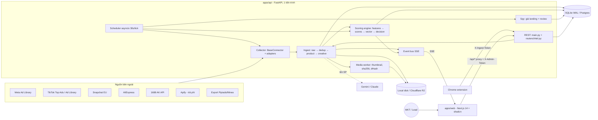
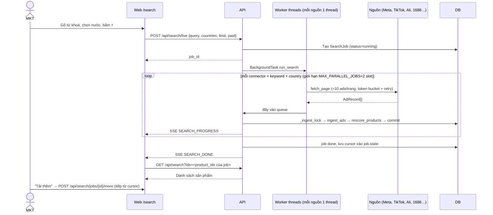
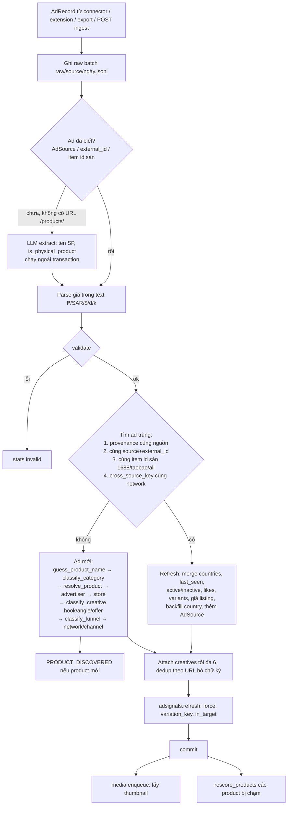
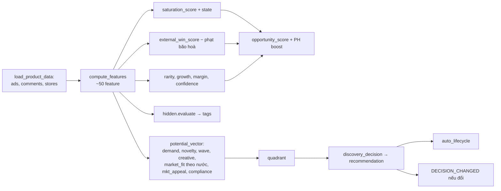
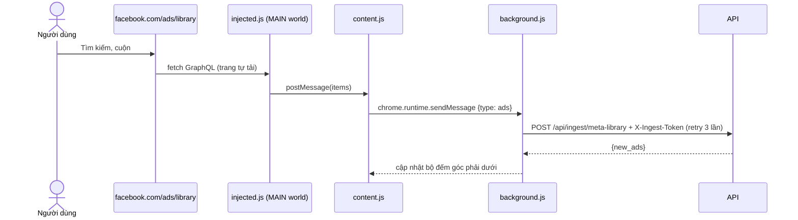
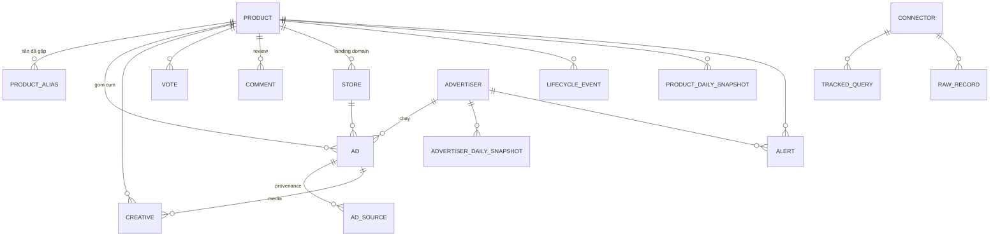

# ToolSpy (Market Intelligence OS): phân tích nghiệp vụ và thiết kế hệ thống

> Phiên bản: 09/10/2026, commit `dd7b85f`. Viết dựa trên **code thực tế** trong repo, không dựa trên README. Chỗ nào tài liệu cũ nói khác code thì ghi rõ ở mục 13.
> Cập nhật 09/10/2026 (chiều): đã xoá dữ liệu nguồn đã bỏ, phân hạng v2, README viết lại; Company Fit được gỡ có chủ đích.
> Số liệu dữ liệu ở mục 12 đọc trực tiếp (read-only) từ `apps/api/market_intel.db` ngày 09/10/2026.

---

## Mục lục

1. [Bài toán kinh doanh](#1-bài-toán-kinh-doanh)
2. [Phạm vi](#2-phạm-vi)
3. [Tác nhân](#3-tác-nhân)
4. [Khái niệm nghiệp vụ](#4-khái-niệm-nghiệp-vụ)
5. [Use case](#5-use-case)
6. [Kiến trúc hệ thống](#6-kiến-trúc-hệ-thống)
7. [Luồng hoạt động](#7-luồng-hoạt-động)
8. [Mô hình dữ liệu](#8-mô-hình-dữ-liệu)
9. [Quy tắc nghiệp vụ và công thức](#9-quy-tắc-nghiệp-vụ-và-công-thức)
10. [API và màn hình](#10-api-và-màn-hình)
11. [Bảo mật, cấu hình, triển khai](#11-bảo-mật-cấu-hình-triển-khai)
12. [Thực trạng dữ liệu](#12-thực-trạng-dữ-liệu-09102026)
13. [Ưu điểm](#13-ưu-điểm)
14. [Nhược điểm và rủi ro](#14-nhược-điểm-và-rủi-ro)
15. [Đề xuất ưu tiên](#15-đề-xuất-ưu-tiên)
16. [Phụ lục: bản đồ file](#16-phụ-lục-bản-đồ-file)

---

## 1. Bài toán kinh doanh

Công ty bán hàng xuyên biên giới theo mô hình **quảng cáo social → chốt đơn qua chat hoặc landing page → giao COD**. Sản phẩm là **hàng vật lý generic nhập từ Trung Quốc**. Có hai đội marketing:

| Đội | Cách bán | Cần gì từ công cụ |
|---|---|---|
| **MKT Mess** | Ads có CTA "Send Message / WhatsApp", sale chốt trong inbox | Tìm sản phẩm đối thủ đang chạy với funnel nhắn tin |
| **MKT Ladi** | Ads dẫn về landing page (Ladipage, Shopify…) có form COD / checkout | Tìm sản phẩm đối thủ đang chạy với funnel landing page, xem giá bán |

Câu hỏi mỗi sáng của marketer: **"Hôm nay test sản phẩm nào, ở thị trường nào, với creative kiểu gì?"**

ToolSpy trả lời bằng ba việc:

1. **Spy quảng cáo**: thu thập quảng cáo đang chạy của đối thủ trên Meta, TikTok (và Snapchat ở EU), gom thành **cụm sản phẩm**.
2. **Kiểm chứng nguồn hàng**: tra giá nhập và số đã bán ở AliExpress / 1688 / Taobao để ước biên lợi nhuận.
3. **Xếp hạng và khuyến nghị**: chấm điểm bằng công thức xác định (không để AI quyết), ra nhãn **TEST_NOW / TEST / WATCH / REVIEW / SKIP**, cập nhật gần realtime.

Thị trường ưu tiên: **Philippines (PH) là số 1** (`PRIORITY_MARKETS=PH`, cộng 15 điểm opportunity), sau đó là Trung Đông (SA, AE, KW, QA, OM, BH, JO, EG, IQ), Mỹ, EU+UK, Úc/NZ, Việt Nam.

---

## 2. Phạm vi

| Trong phạm vi | Ngoài phạm vi (đã gỡ khỏi code) |
|---|---|
| Ads social: Meta (FB/IG/Messenger), TikTok, Snapchat (EU) | Quảng cáo tìm kiếm: Google, Bing |
| Nguồn hàng TQ: AliExpress, 1688, Taobao | Sàn bán lẻ phương Tây: Amazon, Walmart |
| Export từ spy tool trả phí (Pipiads, Minea) | Shopify store spy, TikTok viral organic (gỡ 07/10/2026) |
| Chrome extension lưu ads khi duyệt Meta Ad Library | Dữ liệu nội bộ sau test: đơn hàng, vận đơn, ad metrics, experiment (router `product_fit` và các bảng đã gỡ, xem 14.1) |
| Giá bán đối thủ (từ ad text và landing page), review khách | Dịch vụ, app, thực phẩm/TPCN, thuốc, hàng brand (gắn `category=non_product`, bị loại khỏi xếp hạng) |

Nguyên tắc thiết kế (ghi trong code và docs):

- **Chỉ dữ liệu thật.** Bộ seed demo đã bị xoá. Trường nào nguồn không có thì để `null`.
- **Điểm số luôn do công thức tính từ DB.** LLM chỉ trích xuất (tên sản phẩm, có phải hàng vật lý không) và diễn giải.
- **Không dùng cookie lấy trộm hay giả chữ ký** của spy tool. Chỉ dùng API chính thức, API thương mại, export, webhook, dữ liệu công khai, hoặc headers từ tài khoản của chính người dùng.

---

## 3. Tác nhân

### 3.1 Tác nhân con người

| Tác nhân | Vai trò | Tương tác chính |
|---|---|---|
| **MKT Mess** | Tìm sản phẩm cho funnel nhắn tin | Tìm sản phẩm (lọc `funnel=mess`), Product Radar, Hidden Winners, vote LOVE/TEST/WATCH/NORMAL/SKIP, xem/tải creative |
| **MKT Ladi** | Tìm sản phẩm cho funnel landing page | Như trên với `funnel=ladi`; xem giá bán đối thủ, landing page |
| **Lead / vận hành dữ liệu** (admin) | Quản trị nguồn | Data & Connectors: bật/tắt connector, nhập key/headers, tracked queries, upload export, xem dung lượng, chạy pipeline, merge sản phẩm, chuyển lifecycle |
| **Người dùng extension** | Thu thập thủ công | Duyệt `facebook.com/ads/library`, extension tự đẩy ads về kho; nút "Lưu trang này" cho trang sản phẩm bất kỳ |

Hệ thống **chưa có khái niệm user/role**. Mọi người dùng chung một quyền admin (qua Basic Auth của web + `ADMIN_TOKEN` gắn phía server). Trường `user`/`team` khi vote là chuỗi tự khai.

### 3.2 Tác nhân hệ thống và bên ngoài

| Tác nhân | Loại | Vai trò |
|---|---|---|
| **Scheduler** (asyncio trong tiến trình API) | Nội bộ | Chạy tracked queries, connector định kỳ, liveness, spy giá, media, alerts, rescore 6h, dọn kho |
| **Media worker** (thread pool) | Nội bộ | Lấy thumbnail, tải video khi được yêu cầu, sha256, dHash, gom creative family |
| **Meta Ad Library** (GraphQL công khai qua `meta-ads-collector`) | Nguồn ads | Nguồn chính, không cần key |
| **Meta Graph `ads_archive`** | Nguồn ads | Chính thức, chỉ EU/UK, tắt mặc định |
| **TikTok Creative Center Top Ads** | Nguồn ads | Bản headless (Playwright + Edge/Chrome, không login) bật; bản dán headers tắt |
| **TikTok Ad Library / Commercial Content API** | Nguồn ads | Chỉ ads phân phối ở EU/EEA/UK/CH |
| **Snapchat Ads Library** | Nguồn ads | Chỉ EU, theo tên brand, tắt mặc định |
| **AliExpress** | Nguồn hàng | JSON nhúng trong trang tìm kiếm, miễn phí |
| **1688 AI API (AK, HMAC)** | Nguồn hàng | Miễn phí, ≤20 offer, có số bán 30 ngày; fallback Apify |
| **Apify** (1688, Taobao, TikTok, Meta) | Nguồn trả phí | Chỉ chạy khi người dùng tích "Dùng nguồn trả phí" |
| **Pipiads / Minea** | Spy tool | Qua file export (thư mục watch hoặc upload) hoặc API Enterprise |
| **Gemini / Claude** | LLM | Trích tên sản phẩm, lọc non-product, AI Agent; có fallback rule-based |
| **Cloudflare R2** hoặc đĩa local | Lưu trữ | Thumbnail, media, raw batch |
| **Trình duyệt** | Client | Nhận sự kiện realtime qua SSE |

---

## 4. Khái niệm nghiệp vụ

| Khái niệm | Ý nghĩa trong hệ thống | Nơi định nghĩa |
|---|---|---|
| **Ad** | Một quảng cáo (hoặc một listing nguồn hàng) từ một nguồn. Bảng `ads` dùng chung cho cả ads và listing, phân biệt bằng `channel` | `models.Ad` |
| **Channel** | `ads` (ad library), `commerce` (nguồn hàng TQ), `organic` (viral, đã bỏ). Chỉ `ads` được đếm vào chỉ số thị trường (`ADS_ONLY`) | `platforms.py` |
| **Network** | Gom placement: facebook/instagram/messenger → `meta`. Dùng cho bộ lọc, ngân sách lưu trữ, chấm điểm | `platforms.NETWORKS` |
| **Product (cụm sản phẩm)** | Thực thể trung tâm. Nhiều ad của nhiều advertiser gom về một product qua entity resolution. Mã `PRD_0000123` | `models.Product`, `entity_resolution.py` |
| **Advertiser** | Page / shop chạy ads. Có cờ `is_competitor_watched` | `models.Advertiser` |
| **Creative** | Một file media (video/ảnh) của ad, định danh theo sha256, gom family theo dHash | `models.Creative`, `media.py` |
| **Funnel** | `mess` / `ladi` / `form` / `app` / `other`, suy ra từ CTA rồi landing host | `ingest.classify_funnel` |
| **Target markets** | Các nước được tính vào số liệu "tất cả". Ads nước khác vẫn lưu nhưng không lẫn vào | `markets.py`, `TARGET_MARKETS` |
| **Priority market** | PH: cộng `PRIORITY_BOOST` (15) vào opportunity | `markets.priority_boost` |
| **Force score** | Sức mạnh một ad: số ngày chạy (60) + số biến thể (25) + số placement (15); ×0,7 nếu đã dừng. Tier: legendary ≥70, strong ≥45, regular ≥20, testing | `adsignals.py` |
| **Liveness** | Xác minh ad còn chạy bằng cách hỏi lại nguồn; 2 lần liên tiếp không thấy mới đánh dấu dừng | `realtime.verify_liveness` |
| **Hidden Winner** | Ít người bán (≤5) nhưng có ad mạnh (force ≥45), điểm ≥55 | `services/hidden.py` |
| **Product Potential Vector** | Vector 10+ chiều: demand, novelty, wave, creative, market fit, MKT appeal, competition, economics, compliance, confidence → opportunity | `services/discovery.py` |
| **Quadrant** | BREAKOUT / EXPERIMENTAL / STABLE_WINNER / LOW_SIGNAL theo wave × demand | `discovery.potential_vector` |
| **Recommendation** | TEST_NOW / TEST / WATCH / REVIEW / SKIP (trước test) | `discovery.discovery_decision` |
| **Lifecycle** | DISCOVERED → WATCHLIST → CANDIDATE → TESTING → WIN/HOLD/FAIL → SCALE → SATURATED → RETIRE | `services/decision.py` |
| **Vote / Taste Model** | Team vote sản phẩm; mô hình học điểm trung bình theo feature (category, market, hook, angle, funnel) để dự đoán MKT appeal | `discovery.TasteModel` |
| **Tracked query** | Từ khoá / page đối thủ được scheduler chạy lại định kỳ | `models.TrackedQuery` |
| **Search job** | Một lượt "Tìm trực tiếp trên nguồn" từ UI, có con trỏ resume để "Tải thêm" | `models.SearchJob` |

---

## 5. Use case

| # | Use case | Tác nhân | Mô tả ngắn |
|---|---|---|---|
| UC1 | Tìm trong kho | MKT | Từ khoá (nhiều từ khoá `a \| b`), loại trừ, nước/vùng, funnel, network, media, số ngày chạy tối thiểu, số advertiser tối đa, quyết định, quadrant |
| UC2 | Tìm trực tiếp trên nguồn (live search) | MKT | Quét song song mọi connector có `supports_search`, kết quả hiện dần qua SSE, "Tải thêm" từ chỗ dừng |
| UC3 | Xem Product Radar | MKT | Bảng theo thị trường × khung thời gian: xu hướng, số ads, sellers, tuổi, điểm, ad mạnh nhất |
| UC4 | Product Discovery | MKT | Opportunity Radar + các tab (Breakout, Experimental, High Wave, Creative Goldmine, MKT Favorites, Hợp Mess/Ladi…) |
| UC5 | Hidden Winners | MKT | Danh sách sản phẩm ít người bán nhưng ad mạnh, kèm tag (đang tăng nhanh, chạy ≥90 ngày, nhân bản, chỉ 1 người bán…) |
| UC6 | Xem chi tiết sản phẩm (Product 360) | MKT | Ads, advertiser, creative, điểm và breakdown, giá đối thủ theo từng advertiser, nguồn hàng, review, lý do khuyến nghị |
| UC7 | Quét giá & review đối thủ | MKT | `POST /api/products/{id}/scan` (~30s): fetch landing page lấy giá, lấy review AliExpress |
| UC8 | Vote sản phẩm | MKT | LOVE/TEST/WATCH/NORMAL/SKIP + lý do; vote LOVE/TEST/WATCH bảo vệ media khỏi bị dọn |
| UC9 | Thư viện quảng cáo / Creative Vault | MKT | Xem từng ad như Meta Ad Library, phát video, tải về, ghim 📌 |
| UC10 | Market Radar, Daily Pulse, Competitor Radar | MKT, Lead | Tổng hợp theo nước, theo advertiser; theo dõi đối thủ |
| UC11 | Alerts | MKT, Lead | new_entrant, new_market, creative_velocity_spike, price_change, saturation_increasing, competitor_scaling… |
| UC12 | AI Agent | MKT | Hỏi bằng ngôn ngữ tự nhiên, LLM dịch ra truy vấn có cấu trúc, số liệu lấy từ DB |
| UC13 | Quản lý connector | Lead | Thêm/sửa/xoá, test, sync, xem health, che trường bí mật |
| UC14 | Quản lý tracked queries | Lead | Thêm/sửa/xoá/chạy ngay; `bootstrap_markets` tạo bộ từ khoá theo thị trường |
| UC15 | Upload export | Lead | File CSV/JSON/XLSX từ Pipiads/Minea |
| UC16 | Lưu ads bằng extension | Người dùng extension | Bắt GraphQL response của Ad Library, gửi `POST /api/ingest/meta-library` |
| UC17 | Quản trị kho | Lead | Xem dung lượng theo ngăn, dọn (dry-run), chạy pipeline, merge sản phẩm trùng, đổi lifecycle |

---

## 6. Kiến trúc hệ thống

### 6.1 Sơ đồ thành phần



### 6.2 Công nghệ

| Lớp | Công nghệ |
|---|---|
| Backend | Python 3.11, FastAPI, SQLAlchemy 2, Pydantic 2, uvicorn |
| Thu thập | `meta-ads-collector` (curl_cffi), httpx, curl_cffi giả Chrome, Playwright (TikTok headless), boto3 (R2) |
| Media | Pillow (thumbnail, dHash), ffmpeg qua `imageio_ffmpeg` |
| DB | SQLite (WAL, busy_timeout 60s, mặc định) hoặc PostgreSQL (`DATABASE_URL`) |
| Frontend | Next.js 14.2, React 18, Tailwind 4, shadcn/radix, recharts, sonner |
| Extension | Chrome MV3: `injected.js` (MAIN world, bắt fetch GraphQL), `content.js`, `background.js` |
| AI (tuỳ chọn) | Gemini (mặc định, có cooldown khi 429) → Claude → rule-based |
| Hạ tầng | 2 Dockerfile (api kèm ffmpeg, web), không gắn nhà cung cấp |

### 6.3 Ranh giới module

```
Connector (authenticate · fetch · extract · map)  →  AdRecord (Common Data Contract)
   →  ingest_ads()  →  DB + raw batch + Creative pending
   →  rescore_products(product_ids)  →  events.publish()  →  SSE
```

- Thêm nguồn mới = một class trong `collector/adapters/`, đăng ký ở `collector/factory.py`, một dòng `ADAPTER_NETWORK` trong `platforms.py`.
- Frontend chỉ gọi API nội bộ qua `/api/*`, không gọi nguồn ngoài.

---

## 7. Luồng hoạt động

### 7.1 Tìm trực tiếp trên nguồn (live search)



Điểm đáng chú ý:

- Nguồn trả phí (adapter `apify*`) chỉ chạy khi body có `paid=true` (checkbox trên UI, lưu localStorage).
- 1688: nếu bật cả `ali1688` và `apify_1688`, Apify chỉ là fallback khi AK lỗi hoặc trả ít hơn `min_results`.
- Fetch chạy song song theo nguồn, **ghi DB chỉ trên một luồng** (SQLite một writer).

### 7.2 Ingest (một batch AdRecord)



### 7.3 Chấm điểm và ra quyết định (mỗi product)



Khi nào chạy:

- **Incremental**: sau mỗi ingest (chỉ product bị chạm), sau vote.
- **Toàn bộ**: mỗi 6 giờ (`_daily_job`: `score_all` + `build_snapshots`), hoặc `POST /api/pipeline/run`.
- `ScoreContext` (Taste Model + Market DNA) cache 5 phút.

### 7.4 Scheduler (tick 30 giây, trong tiến trình API)

| Việc | Chu kỳ | Hàm | Ghi chú |
|---|---|---|---|
| Connector có `every_minutes` | theo cấu hình | `run_connector` | Export folder chỉ chạy khi có file mới |
| Tracked queries | `every_minutes` mỗi query (PH 30 phút) | `run_connector(query=q)` | Quá hạn lâu nhất chạy trước |
| Media | 2 phút | `enqueue_pending` | Hết hạn link chết trước; ưu tiên in_target → opportunity → force |
| Alerts | 15 phút | `run_alerts` | So với snapshot 7 ngày trước |
| Spy giá & review | `SPY_EVERY_MIN` (10 phút) | `spy.scan` | 40 URL/lượt, ưu tiên WATCHLIST/TESTING/CANDIDATE, cache 14 ngày |
| Liveness | 20 phút | `verify_liveness` | 12 advertiser/lượt, chỉ refresh ad đã biết |
| Dọn kho | 6 giờ + ngay sau 0h (UTC+7) | `retention.run_cleanup` | Video theo lứa ngày, ảnh 30 ngày, raw 90 ngày, events 30 ngày |
| Rescore + snapshot | 6 giờ | `_daily_job` | commit mỗi 50 product |

Giới hạn đồng thời: `MAX_PARALLEL_JOBS=2` slot dùng chung cho job scheduler và thread live search.

### 7.5 Media (Creative Vault)

Mặc định (`VIDEO_DOWNLOAD=0`) hệ thống **không tải video hàng loạt**:

1. Ingest tạo `Creative` trạng thái `pending` với URL CDN gốc (có chữ ký, hết hạn sau vài giờ).
2. Worker lấy **một thumbnail JPEG ≤480px** (frame bìa của video hoặc chính ảnh), lưu `thumbs/<sha>.jpg`.
3. Khi người dùng bấm Play, player phát thẳng URL nguồn (bản SD nếu có).
4. File đầy đủ chỉ tải khi người dùng yêu cầu (`POST /api/creatives/{id}/retry`) hoặc bật `VIDEO_DOWNLOAD=1`: sha256 → `creatives/<aa>/<sha>.<ext>` → poster → dHash → gán family (Hamming ≤10).
5. Link đã hết hạn chuyển `expired`; lần sync sau của ad sẽ đưa link mới.
6. Ngân sách R2 chia theo ngăn `STORAGE_SHARES=meta:45,tiktok:30,ads_other:10,commerce:15` của `R2_MAX_GB` (20 GB). Local chỉ dừng khi đĩa còn dưới `MIN_FREE_GB`.
7. Không bao giờ tự xoá: creative ghim, sản phẩm có vote LOVE/TEST/WATCH, ad lưu bằng extension.

### 7.6 Chrome extension



Extension không gọi Meta thay người dùng, chỉ đọc dữ liệu trang đã tải. Có thêm nút "Lưu trang này" → `POST /api/ingest/products`.

### 7.7 Realtime (SSE)

- `events.publish(type, data, product_id, persist)` → ghi bảng `events` (nếu persist) + fan-out tới các `asyncio.Queue` của client.
- `GET /api/events/stream` (route Next.js `app/api/events/stream/route.ts` proxy sang API).
- Sự kiện chính: `SEARCH_PROGRESS`, `SEARCH_DONE`, `PRODUCT_DISCOVERED`, `DECISION_CHANGED`, `CREATIVE_STORED`, `AD_REACTIVATED`, `LIVENESS_CHECKED`, `STORAGE_ROLLOVER`, `CONNECTOR_SYNCED`.
- Frontend: `lib/realtime.ts` + `components/layout/realtime-toasts.tsx` hiện toast và tự reload trang liên quan. Cache 60s phía API bị xoá khi có `SEARCH_DONE` / `CONNECTOR_SYNCED`.

### 7.8 Vòng đời sản phẩm

```mermaid
stateDiagram-v2
  [*] --> DISCOVERED
  DISCOVERED --> WATCHLIST: opportunity ≥ 50 (tự động)
  DISCOVERED --> CANDIDATE: recommendation TEST/TEST_NOW (tự động)
  WATCHLIST --> CANDIDATE: recommendation TEST/TEST_NOW (tự động)
  CANDIDATE --> TESTING: thủ công
  TESTING --> WIN
  TESTING --> HOLD
  TESTING --> FAIL
  WIN --> SCALE
  WIN --> SATURATED: Highly Saturated / Declining (tự động)
  SCALE --> SATURATED: tự động
  SATURATED --> RETIRE
  FAIL --> RETIRE
  RETIRE --> WATCHLIST
```

Tự động chỉ ở ba chỗ trên; các bước từ TESTING trở đi là **thủ công** (`POST /api/products/{id}/lifecycle`), vì dữ liệu kết quả test nội bộ không còn trong hệ thống. `RETIRE` thủ công không bao giờ bị tự động đảo ngược.

---

## 8. Mô hình dữ liệu

### 8.1 ERD rút gọn



### 8.2 Các bảng

| Bảng | Vai trò | Trường quan trọng |
|---|---|---|
| `products` | Thực thể trung tâm, chứa **điểm đã tính sẵn** (denormalized) | `product_code`, `canonical_name`, `category`, `country`, `lifecycle_status`, `features` (JSON), `external_win_score`, `saturation_score/state`, `opportunity_score`, `confidence_score`, `potential` (JSON), `market_scores` (JSON theo nước), `classification`, `recommendation(+reasons)`, `funnel_mix`, `in_target`, `cover_creative_id`, `tags` |
| `product_aliases` | Mọi tên thô của một product | `name`, `source`, `match_score` |
| `ads` | Ads **và** listing nguồn hàng | `source`, `external_id`, `network`, `channel`, `country`/`countries`, `funnel`, `cta_type`, `landing_url`, `price`/`price_source`/`currency`, `variants`, `platforms`, `is_active`, `last_verified_at`, `verify_misses`, `force_score`/`force_tier`, `variation_key`, `in_target`, `hook`/`angle`/`offer`, `creative_fingerprint`, `sold_count`/`rating` (listing), `search_text` |
| `ad_sources` | Ai đã báo cáo ad này, khi nào | `source`, `source_ad_id`, `raw_key`, `saved_by` |
| `advertisers` | Page / shop | `name`, `platform`, `country`, `is_competitor_watched` |
| `stores` | Landing domain | `domain`, `product_id`, `price` |
| `creatives` | Media | `status` (pending/stored/failed/expired/archived/skipped), `source_url`, `thumb_key`, `storage_key`, `sha256`, `phash`, `family_id`, `pinned`, `stored_bytes` |
| `votes` | Đánh giá của MKT | `user`, `team` (mess/ladi), `market`, `decision`, `reasons`, `note` |
| `comments` | Review khách | `source` (review/landing_review…), `rating`, `overall`, `aspects`, `external_id` |
| `alerts` | Cảnh báo | `type`, `severity`, `dedupe_key`, `is_read` |
| `events` | Feed realtime | `type`, `product_id`, `data` |
| `connectors` | Cấu hình nguồn | `adapter`, `config` (JSON, có secret), `enabled`, `every_minutes`, `status`, `health`, `last_sync_*` |
| `tracked_queries` | Từ khoá theo dõi | `query`, `page_ids`, `countries`, `every_minutes`, `last_run_at`, `last_new`, `last_error` |
| `search_jobs` | Lượt live search | `query`, `countries`, `adapters`, `status`, `state` (cursor), `sources` (thống kê từng nguồn), `product_ids` |
| `*_daily_snapshots` | Lịch sử theo ngày (product, market×category, advertiser) | Dùng cho tăng trưởng và alerts |
| `raw_records`, `pipeline_runs`, `lifecycle_events` | Audit | |

Lưu ý thiết kế: `Product.features`/`potential`/`market_scores` là JSON tính lại toàn bộ mỗi lần chấm, nên UI đọc nhanh nhưng không truy vấn SQL theo từng thành phần được.

---

## 9. Quy tắc nghiệp vụ và công thức

### 9.1 Phân loại funnel (`ingest.classify_funnel`)

Thứ tự ưu tiên:

1. CTA thuộc nhóm nhắn tin (`MESSAGE_PAGE`, `WHATSAPP_MESSAGE`…) hoặc chữ CTA khớp `message|whatsapp|chat|inbox|nhắn tin|zalo|واتساب`, hoặc host `m.me`, `wa.me`, `zalo.me`… → **mess**
2. Landing ngoài social + CTA kiểu `shop now|order now|buy now|mua ngay|اطلب` → **ladi**
3. Host app store → **app**; host marketplace (amazon, noon, aliexpress, temu) → **other**
4. CTA dạng form (SIGN_UP, GET_QUOTE…) và không có landing ngoài → **form**
5. Có landing ngoài social → **ladi**
6. Ad text có "inbox / nhắn tin / whatsapp" → **mess**; còn lại → **other**

### 9.2 Đặt tên sản phẩm (`guess_product_name`)

Gợi ý LLM / tiêu đề link → slug landing page nếu là trang `/products/…` → advertiser + "(chưa đặt tên)". **Không bao giờ dùng ad copy** (tiêu đề dài >9 từ, có dấu câu cuối, kiểu CTA đều bị loại).

### 9.3 Giá

- Từ ad text (`parse_price`): ₱/PHP/SAR/AED/QAR/KWD/$/€/£/A$/đ/₫, viết tắt "199k" / "2tr" chỉ khi là quảng cáo tiếng Việt; bỏ các số đếm ("15 triệu chai đã bán").
- Từ landing page (`spy.py`): Shopify `/products/x.json`, JSON-LD `offers`, `og:price`; bỏ qua host inbox/app/marketplace.
- `sell_usd` = median giá các ad có giá (quy USD). `supplier_price_usd` từ AliExpress/1688.
- Biên gộp ước tính: `1 − giá_nhập × 1,6 / giá_bán`.

### 9.4 Force score một ad (`adsignals.py`)

```
force = min(ngày_chạy/180, 1)·60 + min(max(variants−1,0)/9, 1)·25 + min(số_placement/4, 1)·15
        × 0,7 nếu ad đã dừng
tier:  ≥70 legendary · ≥45 strong · ≥20 regular · còn lại testing
```

### 9.5 Hidden Winner (`services/hidden.py`)

Điều kiện: không phải `non_product`, còn ít nhất 1 ad active, **≤5 advertiser**, ad mạnh nhất force ≥45.

```
score = 0,40·force_max + 0,25·rarity + 0,20·min(ads_mới_7d/5,1)·100 + 0,15·min(biến_thể/10,1)·100
rarity = (1 − (n_adv−1)/5)·100      ; giữ nếu score ≥ 55
```

### 9.6 Điểm thị trường (`services/scoring.py`)

| Điểm | Thành phần chính (trọng số) |
|---|---|
| **Saturation** | Mật độ advertiser tại thị trường chính dạng chuông: <2 → 15, 2–10 → 0, >10 tăng dần (0,25); trùng creative (0,15); số ads active (0,15); số store (0,15); giảm tốc (0,10). Trạng thái: <25 Low, <45 Growing, <68 Competitive, còn lại Highly Saturated; Declining nếu ads mới giảm >50% |
| **External Win** | Longevity (0,15), creative velocity (0,15), advertiser growth (0,10), diversity (0,10), mở rộng địa lý (0,10), engagement (0,10), store momentum (0,10), cross-platform (0,12, chỉ khi có listing/viral). Trừ `0,6 × (saturation − 60)` |
| **Rarity** | Ít advertiser (0,35), ít ads (0,25), ít store (0,20) |
| **Confidence** | Số ads (0,25), advertiser (0,20), số ngày có dữ liệu (0,20), số thị trường (0,10), số nguồn (0,10) |
| **Opportunity** | `(0,5·win + 0,2·(100−sat) + 0,15·growth + 0,15·margin) × (0,4 + 0,6·conf/100)` + PH boost 15 |

Các feature chưa có nguồn (keyword_competition, traffic, search_trend, comment sentiment) đang để **trọng số 0** và được đánh dấu `ponytail:` trong code.

### 9.7 Product Potential Vector và quyết định (`services/discovery.py`, ranking v2 từ 09/10/2026)

- **demand** (đã được xác nhận) = 35% ad mạnh nhất đã chạy bao lâu (log, 7→120 ngày) + 30% nhân bản (max của số ads active, biến thể, số ad mạnh) + 20% số người bán dạng chuông (1 → 0, 2 → 60, 3–10 → 100, 11–15 → 70, >15 → 40) + 15% số thị trường.
- **momentum** (đang tăng) = 60% ads mới 7 ngày (0→5) + 40% người bán mới 7 ngày (0→3).
- **novelty, wave, creative** như cũ (wave/creative là regex trên ad copy nên chỉ chiếm 16% trọng số).
- **market_fit** theo từng nước, **mkt_appeal** từ vote / Taste Model, **compliance_risk** bằng regex.

```
raw = 0,28·demand + 0,14·momentum + 0,12·fit + 0,10·appeal + 0,08·novelty + 0,08·wave + 0,08·creative + 0,12·economics
      − 0,12·max(0, competition−30) − 0,5·max(0, risk−20)
opportunity = clamp(raw × (0,75 + 0,25·conf/100)) + PH boost, rồi giới hạn theo nhãn: SKIP/REVIEW ≤ 30, WATCH ≤ 55
quadrant: momentum≥40 & demand≥50 → BREAKOUT · momentum≥40 → EXPERIMENTAL · demand≥50 → STABLE_WINNER · còn lại LOW_SIGNAL
```

`product.opportunity_score` = opportunity của vector (một con số xếp hạng dùng chung cho danh sách, radar, tìm kiếm, thứ tự tải media).

Quyết định (theo thứ tự, dừng ở điều kiện đầu tiên khớp):

| Điều kiện | Kết quả |
|---|---|
| Không có ad nào đang chạy | **SKIP** |
| `non_product`, hoặc ≥50% ads là app / form đăng ký | **SKIP** |
| compliance ≥ 60 | **REVIEW** |
| >15 người bán (tổng hoặc ở thị trường ưu tiên), hoặc saturation ≥ 70 | **SKIP** |
| Tên là placeholder / câu CTA và demand ≥ 45 | **WATCH** |
| BREAKOUT, ad lâu nhất ≥ 14 ngày, market_fit ≥ 50 | **TEST_NOW** |
| BREAKOUT hoặc EXPERIMENTAL | **TEST** |
| demand ≥ 55 và (≥2 người bán hoặc ≥2 biến thể) | **TEST** |
| demand ≥ 45 hoặc momentum ≥ 20 | **WATCH** |
| còn lại | **SKIP** |

Lý do khuyến nghị luôn kèm số ads đang chạy, số người bán và số ngày của ad lâu nhất.

### 9.8 Alerts (`services/alerts.py`)

Đang bật: `new_entrant`, `new_market`, `creative_velocity_spike`, `price_change`, `store_traffic_spike`, `negative_comments_increasing`, `saturation_increasing`, `competitor_scaling`. **Tắt** (`MUTED`): `hidden_winner`, `milestone` vì từng tạo ~1.000 alert rác/ngày. Dedupe theo `type:product:advertiser:ngày|tuần`.

### 9.9 Entity resolution (`services/entity_resolution.py`)

So tiêu đề đã chuẩn hoá (bỏ stopword, map đồng nghĩa đa ngôn ngữ), slug URL, khoảng giá, category, brand; ngưỡng `MATCH_THRESHOLD=0,62`. Chưa dùng embedding ảnh/video (có chỗ cắm `_extra_similarity`).

---

## 10. API và màn hình

### 10.1 Nhóm API

| Nhóm | Endpoint chính | File |
|---|---|---|
| Sản phẩm | `GET /api/products`, `/api/products/{id}`, `/api/products/hidden-winners`; `POST …/lifecycle`, `…/explain`, `…/scan`, `…/vote`, `/api/products/merge` | `main.py`, `intel.py` |
| Tìm kiếm | `GET /api/search`; `POST /api/search/live`; `GET/POST /api/search/jobs/{id}(/more)` | `intel.py` |
| Ads & creative | `GET /api/ads`, `/api/creatives`, `/api/creatives/{id}/download`, `/thumb`; `POST …/retry`, `…/pin` | `intel.py` |
| Discovery & radar | `/api/discovery/meta`, `/tab/{tab}`, `/radar`, `/market-dna`; `/api/markets/live`; `/api/radar/products`; `/api/dashboard/pulse` | `intel.py`, `main.py` |
| Đối thủ | `GET /api/competitors(/{id})`; `POST …/watch` | `main.py` |
| Alerts | `GET /api/alerts`; `POST /api/alerts/{id}/read`, `/read-all` | `main.py` |
| Collector | `GET /api/collector`; CRUD `/api/collector/connectors`, `…/test`, `…/sync`, `…/status`; CRUD `/api/collector/queries`, `…/run`; `/export-upload`; `/liveness`; `/scheduler` | `intel.py` |
| Ingest (token riêng) | `POST /api/ingest/ads`, `/products`, `/creatives`, `/meta-library` | `intel.py` |
| Kho | `GET /api/storage/usage`; `POST /api/storage/cleanup` | `intel.py` |
| Hệ thống | `/api/meta`, `/api/health`, `/api/events(/stream)`, `/api/pipeline/run`, `/api/agent/ask`, `/api/import/*` | `main.py`, `intel.py` |

### 10.2 Màn hình (sidebar `components/layout/nav.ts`)

| Nhóm | Màn hình | Trạng thái |
|---|---|---|
| Khám phá sản phẩm | Tìm sản phẩm, Product Radar, Product Discovery, Hidden Winners | Hoạt động |
| Nguồn dữ liệu | Thư viện quảng cáo, Nguồn hàng & Store, Creative Vault | Hoạt động |
| Thị trường | Daily Pulse, Market Radar, Xếp hạng sản phẩm, Competitor Radar | Hoạt động |
| Hệ thống | Alerts, AI Agent, Data & Connectors | Hoạt động |

---

## 11. Bảo mật, cấu hình, triển khai

### 11.1 Bảo mật

| Lớp | Cơ chế |
|---|---|
| Web | Basic Auth tuỳ chọn (`BASIC_AUTH_USER/PASS`) trong `middleware.js` |
| Ghi vào API | `AdminGuard`: mọi request không phải GET/HEAD/OPTIONS cần `X-Admin-Token`; thiếu `ADMIN_TOKEN` thì trả 503 (fail-closed). Web gắn header phía server, trình duyệt không thấy token |
| Ingest | `X-Ingest-Token` bắt buộc (`INGEST_TOKEN`), fail-closed |
| CORS | Chỉ `WEB_ORIGIN` |
| GET read-only | Middleware `ReadOnlyGets` |
| Secret | Connector config che trường bí mật khi trả về (`_mask`); `_redact` xoá `token=` khỏi thông báo lỗi |
| Chi phí | Apify chỉ chạy khi bật "nguồn trả phí"; budget guard fail-closed |

### 11.2 Biến môi trường chính

| Biến | Mặc định | Ý nghĩa |
|---|---|---|
| `DATABASE_URL` | `sqlite:///./market_intel.db` | DB |
| `ADMIN_TOKEN`, `INGEST_TOKEN`, `WEB_ORIGIN` | — | Bảo mật |
| `TARGET_MARKETS`, `PRIORITY_MARKETS`, `PRIORITY_BOOST` | 6 vùng, `PH`, `15` | Thị trường |
| `STORAGE_BACKEND`, `DATA_DIR`, `R2_*`, `R2_MAX_GB`, `STORAGE_SHARES` | `local`, `./data`, 20 GB | Lưu trữ |
| `VIDEO_DOWNLOAD`, `VIDEO_DAILY_QUOTA`, `VIDEO_KEEP_DAYS`, `MIN_FREE_GB`, `MEDIA_WORKERS` | `0`, 3000, 1, 5, 3 | Media |
| `MAX_PARALLEL_JOBS`, `SPY_EVERY_MIN`, `SPY_URLS_PER_RUN`, `DISABLE_SCHEDULER` | 2, 10, 40 | Scheduler |
| `GEMINI_API_KEY`, `ANTHROPIC_API_KEY`, `CLAUDE_MODEL`, `DISABLE_LLM` | — | AI |
| `APIFY_TOKEN`, `ALI_1688_AK` | — | Nguồn |

### 11.3 Triển khai

- Local: `./start.ps1` (tạo venv, `npm install`, chạy API :8000 và Web :3000).
- Server: 2 container (`apps/api/Dockerfile` có ffmpeg, `apps/web/Dockerfile`). Web proxy `/api/*` sang `API_URL`.
- **Bắt buộc 1 replica API**: scheduler, event bus và các khoá (`_ingest_lock`, `_slots`) nằm trong bộ nhớ tiến trình.
- Connector `tiktok_top_ads_headless` cần Edge/Chrome cài trên máy chạy API (Playwright không tự tải browser), nên container mặc định không chạy được connector này.

---

## 12. Thực trạng dữ liệu (09/10/2026)

| Chỉ số | Giá trị |
|---|---|
| Products | 6.615 |
| Ads | 10.967: meta 6.271 · tiktok 1.407 · aliexpress 1.150 · 1688 334 · taobao 30 · **nguồn đã bỏ 1.775** (amazon 776, shopify 536, walmart 193, google 116, microsoft 108, tiktok_organic 46) |
| Advertisers | 2.816 |
| Creatives | 82.655: pending 71.713 (ảnh 56.162, video 15.551) · skipped video 5.412 · expired 3.254 · failed 2.022 · archived 254 |
| Recommendation | Trước 09/10: WATCH 5.469 (83%) · SKIP 1.076 · TEST 63 · TEST_NOW 5 · REVIEW 2. **Sau ranking v2 + purge (5.392 product):** SKIP 4.614 · WATCH 607 · TEST 168 · TEST_NOW 2 · REVIEW 1 |
| Votes | **2** |
| Alerts | 1.230 |
| Comments (review) | 1.346 |
| Connectors | 28 dòng, 11 đang bật; TikTok Creative Center (dán headers) đang `error`, bản headless `slow` |
| Tracked queries | 56 (49 bật) |
| Search jobs | 74 |

Đọc số liệu:

- `pending` cao là **theo thiết kế** (`VIDEO_DOWNLOAD=0`: chỉ lấy thumbnail, file đầy đủ không tải). Nhưng nó làm trạng thái `pending` mất nghĩa "đang chờ xử lý".
- Chỉ 2 vote nên Taste Model và `mkt_appeal` gần như chưa có tác dụng (cần ≥3 vote cho mỗi feature).
- 83% WATCH: bộ phân loại vẫn chưa tách được nhiều sản phẩm, dù đã tốt hơn hôm 07/10 (lúc đó 0 TEST_NOW).

---

## 13. Ưu điểm

1. **Bám đúng nghiệp vụ Mess/Ladi.** Funnel suy từ CTA trước rồi mới tới landing host. Theo audit, các spy tool phổ biến (PiPiAds, Minea) không có phân loại này.
2. **Kiến trúc connector sạch.** Một hợp đồng dữ liệu chung (`AdRecord`), `BaseConnector` có rate limit/retry/Retry-After, factory + registry network. Thêm nguồn chỉ cần một class.
3. **Provenance và dedup nhiều tầng**: cùng nguồn, cùng item id sàn, cùng creative khác nguồn (chỉ trong cùng network), creative dedup theo URL bỏ chữ ký và sha256.
4. **Điểm số giải thích được.** Công thức xác định, mỗi điểm trả breakdown, ngưỡng calibrate theo percentile thật của DB và có ghi chú trong code. AI không quyết điểm.
5. **Chi phí vận hành gần 0.** Meta, TikTok headless, AliExpress, 1688 AK đều miễn phí; nguồn trả phí phải bật tay và có budget guard; media chỉ lưu thumbnail.
6. **Thị trường tách bạch.** `in_target` tính sẵn, ads ngoài target không lẫn vào số tổng; PH được ưu tiên bằng một tham số.
7. **Liveness thật**: xác minh lại với nguồn, cần 2 lần không thấy mới coi là dừng, có `AD_REACTIVATED`.
8. **Realtime đủ dùng**: SSE, kết quả live search hiện dần, cache 60s xoá theo sự kiện.
9. **Phòng thủ cho SQLite**: transaction ngắn, gọi LLM ngoài khoá ghi, commit theo lô, watchdog log transaction giữ khoá >5s.
10. **Có self-check**: 10 file `test_*.py` (auth, ingest rules, scoring rules, media rules, 1688, spy, TikTok, Meta SSR…) và test offline cho extension.
11. **Bảo mật cơ bản đã có** sau audit 07/10: admin token fail-closed, ingest token, CORS theo env, che token trong lỗi.

---

## 14. Nhược điểm và rủi ro

### 14.1 Nghiệp vụ

| # | Vấn đề | Bằng chứng | Tác động |
|---|---|---|---|
| N1 | ~~**Nhóm màn hình "Nội bộ (Company Fit)" gọi API không còn tồn tại.**~~ Đã gỡ có chủ đích; giao diện (5 trang, mục sidebar, tab Internal & Profit) đã xoá khỏi code 09/10/2026. Backend không còn `/experiments`, `/logistics`, `/attribution`, `/comments/intelligence`, `/learning/profile`, `/webhooks/*` | `grep` trong `apps/api/app` không có kết quả; router `product_fit.py` đã xoá ở `c60bc91` | 5 trang trong sidebar lỗi; người dùng tưởng tính năng có mà thực ra không có |
| N2 | **Không đóng được vòng học.** Thiếu dữ liệu sau test (đơn, giao, hoàn, lợi nhuận) nên SCALE/HOLD/ITERATE/STOP và Learning Loop không thể chạy; lifecycle từ TESTING trở đi hoàn toàn thủ công | Mục 7.8 | Không biết khuyến nghị TEST_NOW có đúng không, không hiệu chỉnh được ngưỡng |
| N3 | **Ít tín hiệu từ team**: 2 vote | Mục 12 | `mkt_appeal`, Taste Model, phần "loved" của Market DNA gần như vô dụng |
| N4 | ~~**Phân hạng còn phẳng**: 83% WATCH~~. Đã sửa (ranking v2, 9.7). Tên kiểu headline ("Don T Miss Out", "Natural Relief In Weeks") nay bị chặn ở nhãn WATCH bằng `NO_PRODUCT_NAME`; gốc rễ (gom cụm theo text) vẫn là N6 | Mục 12 | Cần sửa đặt tên / gom cụm (N6) |
| N5 | **Wave/creative dựa vào regex trên ad copy**, chưa xem nội dung video (không có transcript/OCR dù có cột) | `discovery.creative_signals`; `creatives.transcript/ocr_text` trống | Bỏ sót sản phẩm có video mạnh nhưng copy ngắn hoặc tiếng Tagalog/Ả Rập ngoài lexicon |
| N6 | **Gom cụm sản phẩm dựa vào text**, 82% product có đúng 1 ad (audit 07/10) | `entity_resolution.py` | Mọi feature tăng trưởng/đa advertiser bằng 0 cho đa số product |
| N7 | **Phủ TikTok yếu ở thị trường đích**: Ad Library/Commercial API chỉ EU; Creative Center headless cần browser trên host; bản headers đang `error` | Mục 12 | PH/ME thiếu TikTok, kênh quan trọng của COD |
| N8 | **Không có user/role.** Một token admin chung; `user`/`team` khi vote là chuỗi tự khai | `AdminGuard`, `models.Vote` | Không phân quyền, không truy vết ai làm gì, không cá nhân hoá Mess/Ladi theo người |
| N9 | **Phụ thuộc nguồn không chính thức**: Meta GraphQL qua thư viện bên thứ ba, TikTok headless | `requirements.txt`, `ad_libraries.py` | Meta đổi `doc_id` là mất nguồn chính; rủi ro điều khoản |

### 14.2 Kỹ thuật

| # | Vấn đề | Bằng chứng | Tác động |
|---|---|---|---|
| K1 | **SQLite một writer** làm nút thắt: phải dùng global `_ingest_lock`, `MAX_PARALLEL_JOBS=2` | `realtime.py` (`ponytail: global ingest lock`) | Nhiều người tìm cùng lúc sẽ phải xếp hàng; scale bằng Postgres là bắt buộc trước khi mở rộng team |
| K2 | **Một tiến trình làm mọi việc** (API + scheduler + worker + event bus) | `main._startup` | Không scale ngang; job nặng (rescore 6.6k product) chiếm CPU của request; restart là mất job đang chạy |
| K3 | **Rescore toàn bộ chạy tuần tự trong Python**, mỗi product load lại toàn bộ con | `engine.score_all`, `load_product_data` | Thời gian tăng tuyến tính theo catalog, giữ khoá ghi nhiều đợt |
| K4 | ~~**Dữ liệu nguồn đã bỏ còn trong DB** (1.775 ads)~~ Đã xoá 09/10/2026 (`purge_removed --apply`, backup `market_intel.backup-20261009.db`)., chỉ bị lọc bằng `ADS_ONLY`/`REMOVED_NETWORKS` | Mục 12, `models.ADS_ONLY` | Mỗi truy vấn mới phải nhớ lọc; dễ rò số liệu |
| K5 | **Trạng thái creative bị dùng sai nghĩa**: 71k `pending` dù không bao giờ được tải đầy đủ | `media.enqueue` | Không phân biệt được "đang chờ" với "chỉ có thumbnail"; dashboard dung lượng/backlog khó đọc |
| K6 | **File quá lớn**: `routers/intel.py` 1.227 dòng, `main.py` 673 dòng, endpoint trộn giữa hai file | Mục 16 | Khó review và test |
| K7 | **Điểm lưu dạng JSON** (`features`, `potential`, `market_scores`) | `models.Product` | Không lọc/sắp xếp SQL theo thành phần; phải load vào Python |
| K8 | **Không có migration chính thức**: `create_all` + `auto_migrate` tự thêm cột/index | `db.py` | Đổi kiểu/xoá cột phải làm tay; khó lên Postgres có kiểm soát |
| K9 | **Test là script tự chạy**, không có CI, không có test API end-to-end hay test frontend | `apps/api/test_*.py` | Lỗi như N1 lọt qua |
| K10 | ~~**Tài liệu lệch code**~~ (README và `DATA_SOURCES_AND_DEPLOY.md` đã viết lại 09/10/2026): README còn mô tả HLS 360p/540p, `vod_migrate`, Company Fit realtime tier 0, `.env.example`; code đã xoá `hls.py`, `vod_migrate.py`, router `product_fit`, và không có `.env.example` trong repo | `git show --stat HEAD`, README dòng 74–83 | Người mới làm theo README sẽ sai |
| K11 | **File DB và backup nằm trong thư mục code** (`market_intel.db`, `market_intel.backup-20261007.db`). Đã có trong `.gitignore` nên không bị commit, nhưng không có lịch backup | `apps/api/` | Dễ mất dữ liệu khi dọn thư mục hoặc hỏng ổ; không có bản sao ngoài máy |
| K12 | Connector headless cần trình duyệt trên host nhưng Dockerfile API không cài | `Dockerfile`, `requirements.txt` | Deploy container thì mất nguồn TikTok PH/ME duy nhất đang chạy |

---

## 15. Đề xuất ưu tiên

| Ưu tiên | Việc | Lý do |
|---|---|---|
| P0 | Cập nhật README và `DATA_SOURCES_AND_DEPLOY.md` theo code hiện tại (media chỉ thumbnail, không HLS, không Company Fit); thêm lại `.env.example` | K10 |
| P0 | Chạy `python -m app.purge_removed --apply` (sau backup) | K4 |
| P1 | Quy trình vote hằng ngày cho Mess/Ladi (mục tiêu ≥10 vote/người/tuần), gắn user thật | N3, N8: Taste Model chỉ có ý nghĩa khi có vote |
| P1 | Chuyển sang Postgres, tách scheduler/worker thành tiến trình riêng (giữ nguyên các hàm job trong `realtime.py`) | K1, K2 |
| P1 | Cải thiện gom cụm: theo `page_id` + landing domain + dHash thumbnail | N6 |
| P1 | Ổn định TikTok PH/ME: hoặc Apify Creative Center (~0,11 USD/1k), hoặc image API có browser | N7, K12 |
| P1 | Thêm trạng thái `thumb_only` cho creative | K5 |
| P2 | Đưa lại dữ liệu sau test ở dạng tối thiểu: nhập CSV kết quả test (product, spend, đơn, giao, hoàn) → đánh giá TEST_NOW đúng/sai → hiệu chỉnh ngưỡng | N2 |
| P2 | Transcript (Whisper) / OCR cho video top để tính wave/creative | N5 |
| P2 | Tách `intel.py` theo domain; thêm smoke test gọi mọi endpoint mà frontend dùng | K6, K9 |

---

## 16. Phụ lục: bản đồ file

```
apps/api/app/
  main.py                 FastAPI app, AdminGuard, CORS, startup, endpoint products/competitors/alerts/import/pipeline/agent
  routers/intel.py        search, live search, ingest, creatives, discovery, radar, collector admin, storage, SSE
  models.py               toàn bộ bảng ORM, ADS_ONLY, ad_in_country
  db.py                   engine, ReadOnlyGets, read_only(), auto_migrate, watchdog khoá ghi
  ingest.py               classify_funnel, guess_product_name, parse_price, ingest_ads, dedup, creatives
  realtime.py             run_connector, run_search, scheduler_loop, verify_liveness
  media.py                thumbnail, tải file, sha256, dHash, family, enqueue
  retention.py            ngân sách kho theo ngăn, dọn theo lứa ngày
  storage.py              local / R2, raw batch
  events.py               event bus + SSE
  markets.py              REGIONS, target/priority markets, scope filter
  platforms.py            NETWORKS, channel, REMOVED_*
  bootstrap_markets.py    tạo tracked queries theo thị trường
  purge_removed.py, repair_buckets.py, r2_sync.py   tiện ích vận hành
  collector/
    base.py               BaseConnector, FetchParams, RateLimit, lỗi chuẩn
    contract.py           AdRecord, MediaItem, validate
    factory.py            ConnectorFactory
    adapters/             meta, ad_libraries (TikTok/Snap), ali1688, apify, generic (http/export/apify_actor/tiktok_commercial), marketplaces (AliExpress), free
  services/
    features.py           feature store
    scoring.py            saturation, external win, rarity, confidence, opportunity
    discovery.py          potential vector, taste model, market DNA, compliance, decision
    engine.py             score_product, rescore, snapshots
    hidden.py             Hidden Winners
    adsignals.py          force score, variation key, in_target
    decision.py           lifecycle state machine
    alerts.py             alert engine
    entity_resolution.py  gom cụm sản phẩm
    enrichment.py         category, creative hook/angle, market, FX
    spy.py                giá landing page + review
    connectors.py         connector mặc định, CSV import, raw lake
    llm.py, agent.py      Gemini/Claude, AI Agent
    pipeline.py           chạy tuần tự toàn bộ pipeline
apps/web/                 Next.js: app/<route>/page.tsx, components/ (shadcn), lib/api.ts, lib/realtime.ts, middleware.js
apps/extension/           Chrome MV3 bắt Meta Ad Library
docs/                     thiết kế gốc, audit 07/10, nguồn dữ liệu & deploy
```
